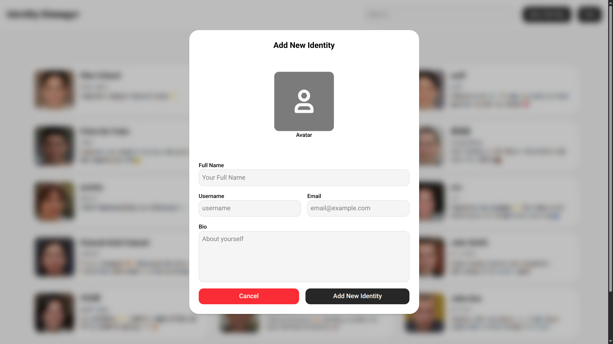

<h1 align="center">Identity Manager</h1>
<p align="center">Identity Manager is Simple IndexedDB API Implementation with Minimalist Dexie.js Wrapper. Built by <a href="https://ahmadrka.com/">Ahmadrka</a> with React (Vite), TypeScript, TailwindCSS, and IndexedDB (Dexie.js).</p>

<details>
	<summary><b>Screenshots</b> <i>(click to view)</i></summary>
	
	
	
</details>

## ⚒️ Tech Stack

- **Dexie.js** -> IndexedDB Wrapper
- React (Vite) -> Frontend Library
- uuid -> Random UUIDv7 Generator
- tailwindcss -> CSS Framework
- Motion -> Animation Library

## 💡 Features

**Database Features:**

- Clean implementation of code and function.
- Fully IndexedDB CRUD using Dexie.js wrapper.
- Dummy data for DB seed.

**Frontend Features:**

- Simple and intuitive UI design.
- Responsive both on desktop and mobile screen.
- Clean per-component code implementation.

**Not Yet Implemented (ToDo):**

- Data filter and sort implementation.
- DB sync with the cloud.
- Data collision and data pollution risk when using cloud sync.
- Adaptive UI dark theme.

## 🚀 Getting Started

This project using Node.js and PNPM, make sure you have installed PNPM and [Node.js](https://nodejs.org/) 22.12 or above.

```bash
# Check if you have installed Node.js
node --version

# Install PNPM using NPM (if not yet)
npx get-pnpm
```

### Project Setup

1. Clone project repository:

```bash
git clone https://github.com/ahmadrka/indexeddb.git
cd indexeddb
```

2. Install all dependencies:

```bash
pnpm install
```

3. Run the project.

```bash
pnpm dev
```

4. Open http://localhost:5173/ and you're in set.

### Start Modification

`src` is main working directory in this project.

```
src
├── assets
│   └── ...
├── components
│   └── ...
├── db
│   ├── db.ts     <-- All db logic function in this file
│   └── seed.ts
├── App.css
├── App.tsx
├── index.css
└── main.tsx
```

Try to make some changes with database logic in [`db.ts`](src/db/db.ts) or call them in your pages or components.

For example, make new file (example `my-db.ts`) to define new database structure:

```js
import { Dexie } from 'dexie';

// Database class
class Data extends Dexie {
  constructor() {
    super('Data');

    this.version(1).stores({
      // Use ++id for auto-increment primary key
      data: '++id, title', // Only for indexes fields
    });
  }
}

// Create database instance from class (you can access db globally)
export const db = new Data();
```

Then use it in your React component:

```jsx
import { db } from './my-db.ts'

export default function App() {
	const data = await db.data.toArray();

	return (
		<div>
			{data.map((item) => (
				<div>
					<h1>{item?.title}</span>
					<p>{item?.content}</p>
				</div>
			))}
		</div>
	)
}
```

**Note:**

- Separate db logic in a function for best practice (consistency, reusable, and more type safe). Examples in [`db.ts`](src/db/db.ts).
- Data stored on Dexie.js are just in client browser storage, but you can make sync with cloud function.
- Make sure to execute code in client component, not server component (eg. use `"use client"` in Next.js, etc).

### Deployment

You can deploy this project on [Vercel](https://vercel.com/), [Netlify](https://www.netlify.com/), VPS, and others deployment platform.

> [!NOTE]
>
> - If you have already setup up this project before, please proceed directly to **step 3**.
> - This project does not require a .env file.

1. Clone project repository:

```bash
git clone https://github.com/ahmadrka/indexeddb.git
cd indexeddb
```

2. Install all dependencies:

```bash
pnpm install
```

3. Build the project:

```bash
pnpm build
```

4. Run built project.

```bash
pnpm preview
```
